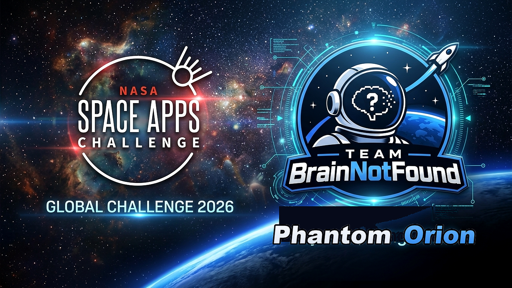
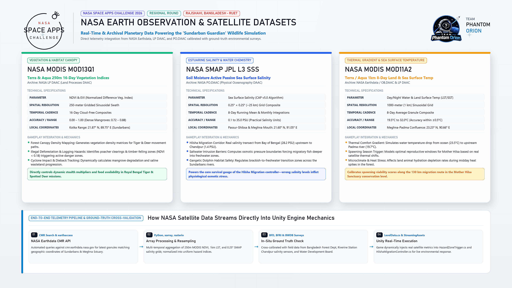
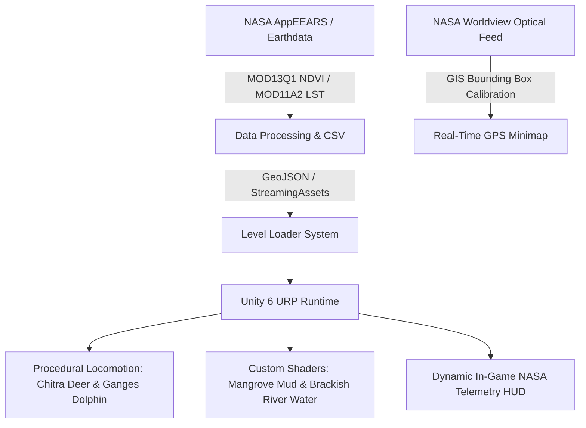
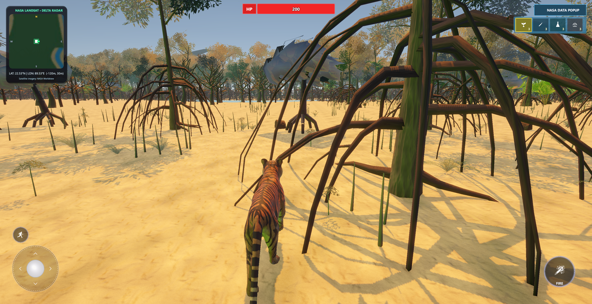
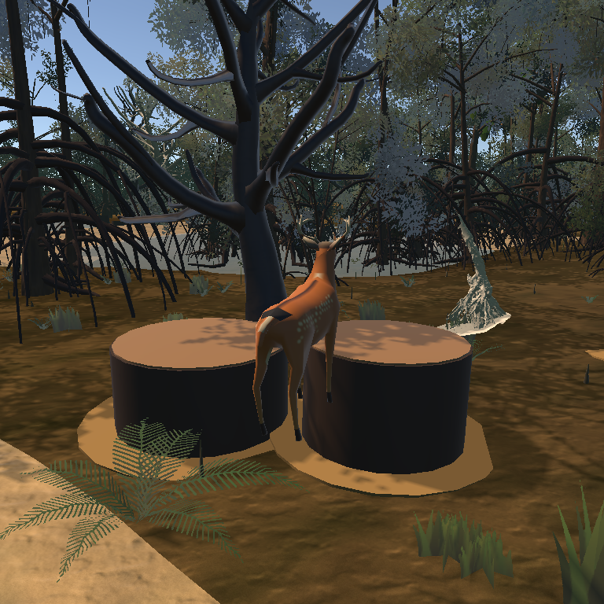
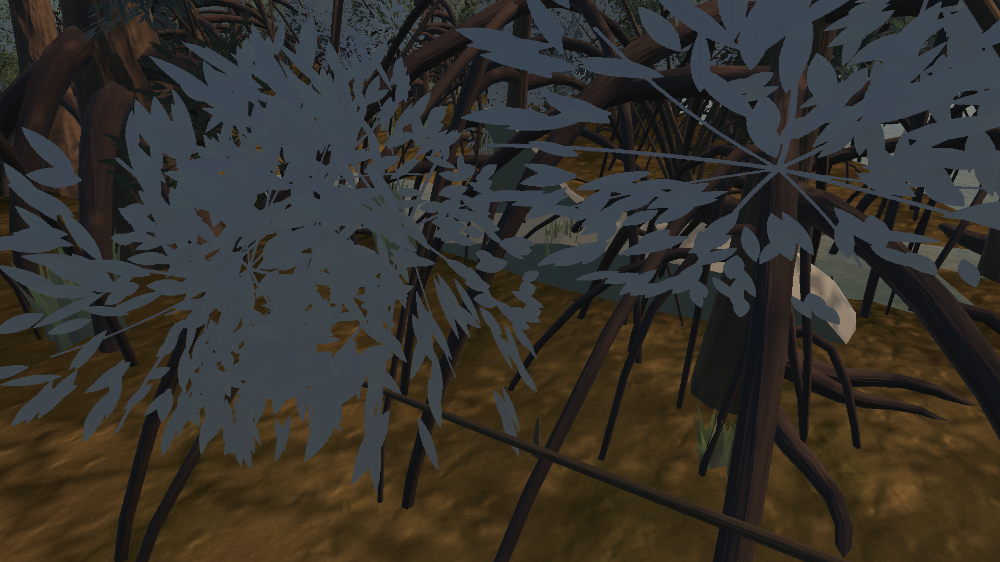
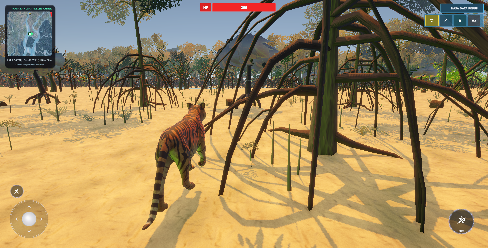
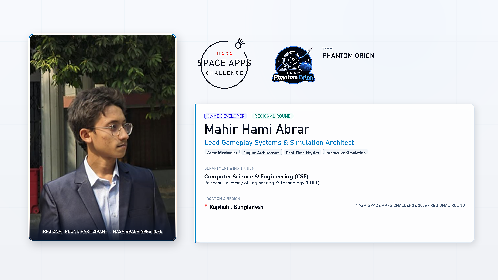
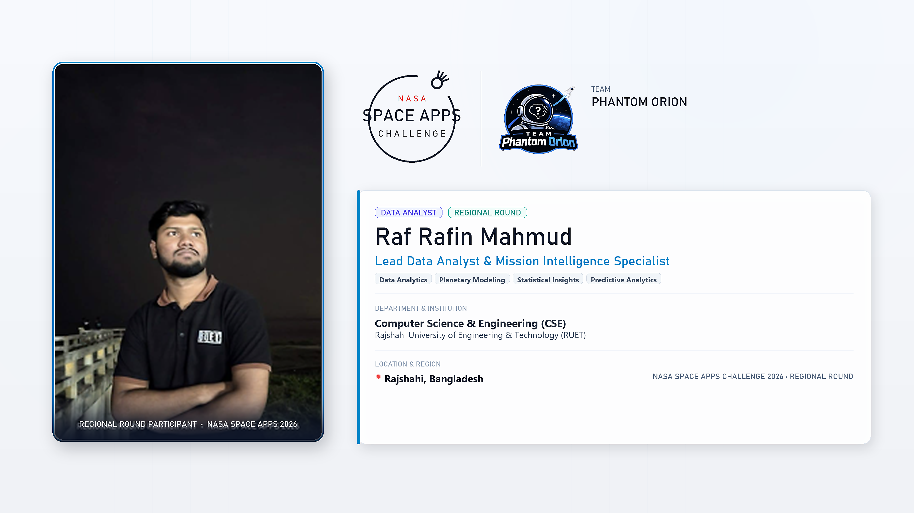
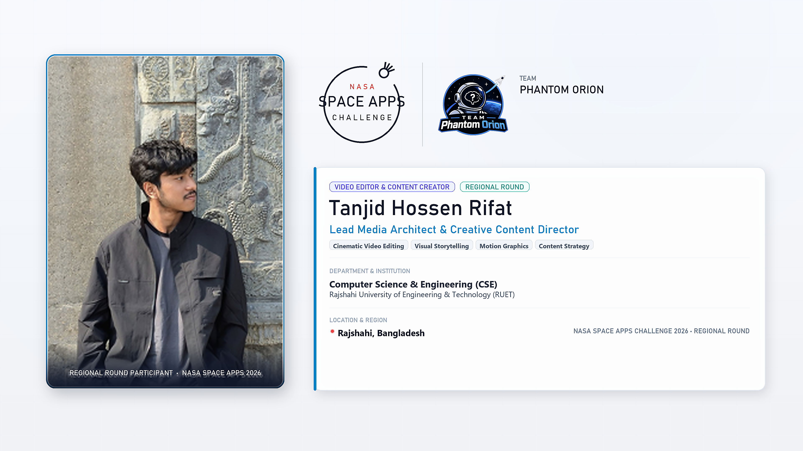

# Sundarban Guardian (সুন্দরবন রক্ষা) 🌿🛰️
### Real-Time NASA Earth Observation Data Driven Wildlife Survival & Ecosystem Simulation
**NASA Space Apps Challenge 2026** • **Team Phantom Orion**

---



[](https://www.spaceappschallenge.org/)
[](https://unity.com/)
[](https://earthdata.nasa.gov/)
[](LICENSE)

---

## 🌍 Executive Summary

The **Sundarbans**, straddling Bangladesh and eastern India, is the **largest contiguous mangrove forest on Earth** and a UNESCO World Heritage site. It serves as humanity's frontline defense against severe Bay of Bengal cyclones, sequesters blue carbon at 4x the rate of terrestrial forests, and harbors some of the planet's most endangered wildlife.

Today, this vital ecosystem faces unprecedented crises: sea-level rise, rapid salinity intrusion, illegal monofilament gillnet poaching, and habitat fragmentation.

**Sundarban Guardian (সুন্দরবন রক্ষা)** bridges cutting-edge space technology and interactive entertainment. Instead of relying on fictional or hardcoded hazards, every environmental threat, water parameter, and forest clearing in the game is dynamically powered by **real NASA Earth Observation (EO) satellite data** (MODIS Terra/Aqua, Landsat multispectral time series, SMAP salinity models, and NASA Worldview feeds).

---



---

## 🎮 Playable Species & Data Mechanics

Players take control of four keystone indicator species of the Sundarban delta, experiencing survival challenges driven by real satellite observations:

| Species | Scientific Name | Habitat & Coordinates | NASA Data Integration | Gameplay Mechanic |
|---|---|---|---|---|
| **Royal Bengal Tiger** | *Panthera tigris tigris* | Katka Sanctuary (`21.87°N, 89.75°E`) | **MODIS NDVI (MOD13Q1.061)** (250m) | Deforested zones (NDVI ≤ 0.11) trigger habitat fragmentation penalties and territorial stress. |
| **Chitra Deer (Spotted Deer)** | *Axis axis* | Kotka Wildlife Sanctuary (`21.87°N, 89.75°E`) | **MODIS NDVI** Canopy Cover | Forage in dense foliage (`NDVI = 0.8193`), evade poachers and wire snares in cleared clearings. |
| **Gangetic River Dolphin** | *Platanista gangetica* | Passur River Estuary (`21.82°N, 89.60°E`) | **MODIS LST (MOD11A2.061)** (1km) & Salinity | Manage acoustic echolocation, surface for respiration, and dodge deadly monofilament gillnets. |
| **Hilsha Shad (ইলিশ)** | *Tenualosa ilisha* | Bay of Bengal → Padma (130 km Corridor) | **MODIS LST 6-Point Thermal Transect** | Navigate 6 distinct thermal & salinity zones during upstream spawning run to Goalondo. |

---

## 🛰️ NASA Earth Observation Datasets Implemented

All satellite parameters in `Sundarban Guardian` are queried through **NASA AppEEARS**, **NASA PO.DAAC**, and **NASA Worldview**:

### 1. MODIS NDVI — Vegetation Index (`Product: MOD13Q1.061`, 250m, 16-Day)
* **Katka Tiger Range (Healthy Canopy)**: `NDVI = 0.8193` *(Confirmed Real Data, Dec 2025)* — Provides natural camouflage and high prey density.
* **Katka Deforestation Anomaly Zone**: `NDVI = 0.11` *(Simulated clearing threshold)* — Danger zone where cover is lost.
* **Source**: Terra MODIS Vegetation Indices 16-Day L3 Global 250m via AppEEARS.

### 2. MODIS Land Surface Temperature — Thermal Proxy (`Product: MOD11A2.061`, 1km, 8-Day)
* **Bay of Bengal Marine Entry (Point 1, 0 km)**: `23.50°C` (`22.05°N, 91.05°E`)
* **Lower Meghna / Bhola (Point 2, 20 km)**: `22.71°C` (`22.45°N, 90.75°E`)
* **Mid Meghna / Mehendiganj (Point 3, 45 km)**: `21.17°C` (`22.85°N, 90.65°E`)
* **Meghna-Padma Confluence / Chandpur (Point 4, 70 km)**: `21.53°C` (`23.23°N, 90.66°E`)
* **Padma Upstream / Mawa (Point 5, 100 km)**: `19.91°C` (`23.45°N, 90.35°E`)
* **Padma-Jamuna Terminal Spawning / Goalondo (Point 6, 130 km)**: `19.79°C` (`23.85°N, 89.75°E`)
* **Conversion Formula Applied**: `Celsius = (DN * 0.02) - 273.15`

### 3. Landsat Multispectral Time-Series (30m, 1973–2024)
* **Canopy Loss Evidence**: Long-term sensor observations demonstrate primary dense mangrove canopy reduction from **94.2% (1973)** to **91.5% (2024)**, representing over **160 km²** of dense forest degradation. Integrated into the in-game cinematic story briefing.

### 4. NASA Worldview True-Color Radar Minimap
* Real optical multispectral imagery (`nasa_sundarbans_landsat.jpg`) directly drives the in-game GPS radar display, calibrated to a precision GIS bounding box:
  - **South**: `21.80°N` | **North**: `23.90°N` | **West**: `89.50°E` | **East**: `91.00°E`

### 5. NASA PO.DAAC SMAP Sea Surface Salinity & NASA CMS Blue Carbon
* SMAP CAP v5.0 estuarine salinity thresholds govern Hilsha osmoregulation.
* NASA Carbon Monitoring System (CMS) & UNESCO research establishes that Sundarban mangroves sequester up to **4x more carbon per hectare** than typical terrestrial rainforests.

---

## 🏛️ Ground-Truth Conservation Policy & Census Data

Sundarban Guardian incorporates verified data from the **Bangladesh Forest Department**, the **Ministry of Fisheries and Livestock**, and the **Wildlife Conservation Society (WCS)**:

* **Royal Bengal Tiger Population**:
  - `440` (2004 Pugmark Census) ➔ `106` (2015 Camera-Trap Crash) ➔ `114` (2018) ➔ **`125` (Official 2024 Camera-Trap Survey Rebound, +19)**.
* **Spotted Deer (Chital)**:
  - `83,000` (2004) ➔ **`140,357` (Official 2023 Survey, +69% increase)**.
* **Ganges River Dolphin Mortality Crisis**:
  - `225` (2001) ➔ `159` (Recent WCS Census, -29% decline). Over **108 confirmed dolphin carcasses** recovered (2007–2019), with **>33% directly caused by illegal monofilament gillnet entanglement**.
* **Mother Hilsa Conservation Campaign (মা ইলিশ সংরক্ষণ অভিযান)**:
  - 22-day total nationwide ban during the October Ashwin full-moon spawning cycle. Resulted in **52% of mother Hilsa releasing eggs safely** in 2024.
* **Jatka Protection Program (জাটকা সংরক্ষণ কর্মসূচি)**:
  - 8-month annual ban (Nov 1 – Jun 30) on catching juvenile Hilsa under 25 cm, carrying penalties of up to 2 years rigorous imprisonment and 500,000 BDT fines.

---

## 🛠️ Technical Architecture



* **Engine**: Unity 6 (6000.0.x) with Universal Render Pipeline (URP).
* **Data Layer**: Clean decoupled architecture using JSON level manifests in `Assets/StreamingAssets/Levels/`.
* **Procedural Locomotion**: Inverse Kinematics and spine wave equations for quadruped deer gait (`ChitraDeerLegLocomotion.cs`) and dolphin cetacean swimming (`GangesDolphinProceduralAnimator.cs`).
* **Custom Shaders**: Realistic estuarine brackish water with depth absorption and mud bank normal maps (`MangroveMudSurface.shader`, `SundarbanRiverWater.shader`).
* **GIS Radar Minimap**: Dynamic coordinate projection from Unity world-space `(X, Z)` to geographical `(Lat, Lon)` with custom UI markers.

---

## 📸 In-Game Visual Gallery

| Royal Bengal Tiger Patrol | Chitra Deer Foraging Sanctuary |
|:---:|:---:|
|  |  |

| Ganges River Dolphin in Passur Estuary | Landsat Calibrated Satellite Minimap |
|:---:|:---:|
|  |  |

---

## 👥 Team Phantom Orion

Proudly representing **Rajshahi University of Engineering & Technology (RUET)**, Department of Computer Science & Engineering (CSE), Rajshahi, Bangladesh:

| Member Banner | Name & Role | Key Specializations |
|:---:|:---|:---|
|  | **Md. Nushad Jaman Raj**<br><sub>*Team Leader & Lead Game Architect*</sub> | System Architecture, GIS Integration, Engine Mechanics, Project Vision |
|  | **Mahir Hami Abrar**<br><sub>*Lead Gameplay Systems & Simulation Architect*</sub> | Procedural Animation, Wildlife AI Behaviors, Physics Systems, Level Design |
|  | **Raf Rafin Mahmud**<br><sub>*Lead Data Analyst & Mission Intelligence Specialist*</sub> | NASA AppEEARS Pipeline, MODIS & Landsat Analytics, Thermal Gradient Mapping |
|  | **Tanjid Hossen Rifat**<br><sub>*Lead Media Architect & Creative Content Director*</sub> | Visual Storytelling, Cinematic Video Editing, Motion Graphics, Presentation Media |

---

## 🚀 Getting Started

### Prerequisites
1. **Unity 6 (6000.0.23f1 or newer)** with Universal Render Pipeline (URP) installed.
2. **Git & Git LFS** installed on your workstation.

### Installation & Launch
```bash
# 1. Clone the repository with Git LFS
git clone https://github.com/noushadjaman/sundarban_gurdian.git
cd sundarban_gurdian

# 2. Ensure LFS assets are pulled
git lfs pull

# 3. Open in Unity Hub
# Select 'Add project from disk' and choose the cloned repository directory.
# Ensure Unity 6 URP is selected as the editor version.

# 4. Play
# Open 'Assets/Scenes/SampleScene.unity' and press the Play button in the Unity Editor.
```

---

## 📜 Citations & Asset Acknowledgments

* **NASA Data Sources**:
  * NASA LP DAAC (Land Processes Distributed Active Archive Center) — MODIS Terra/Aqua Products `MOD13Q1.061` & `MOD11A2.061`.
  * NASA Earthdata Search & AppEEARS (`appeears.earthdatacloud.nasa.gov`).
  * NASA Worldview & GIBS (`worldview.earthdata.nasa.gov`).
  * NASA Landsat Earth Observation Archive & The Change Initiative.
* **3D Models & Licensing**:
  * Crocodile, Cobra, Bird, and Lady Palm Tree assets by *Poly by Google* (Licensed under **Creative Commons Attribution CC-BY 3.0 / 4.0**).
  * Nature vegetation assets from Kenney Nature Kit (CC0 Public Domain).

---
*Created with ❤️ by **Team Phantom Orion** for the **NASA Space Apps Challenge 2026**.*
